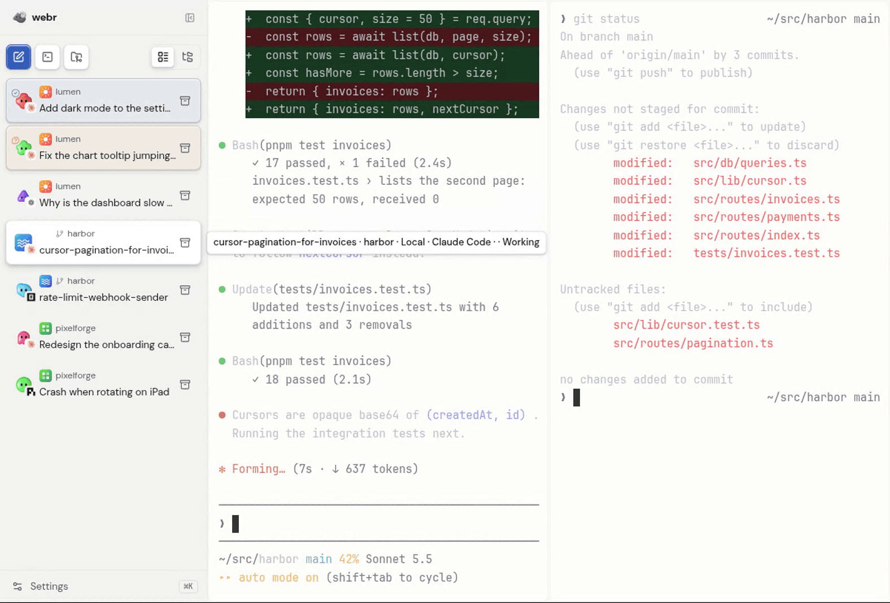
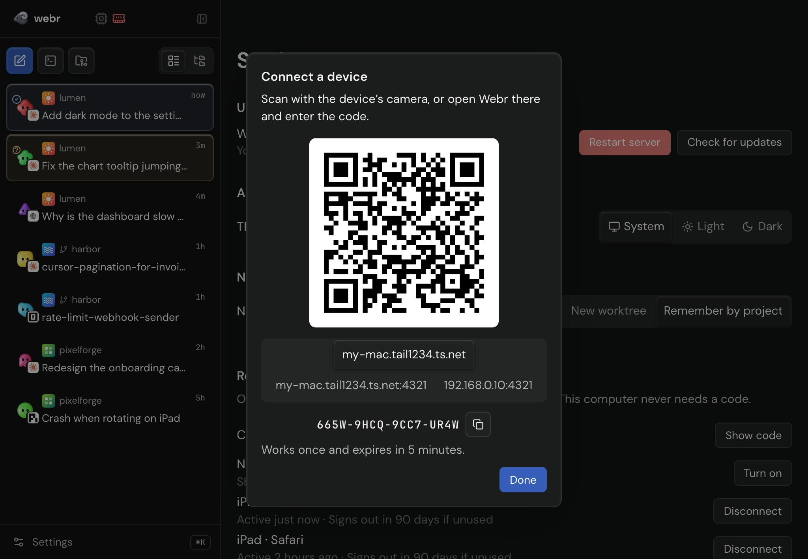
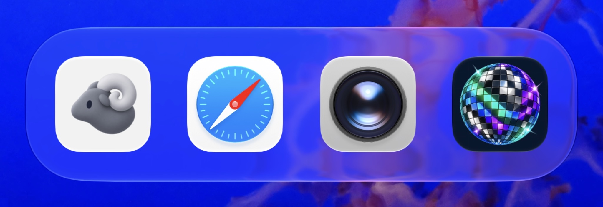
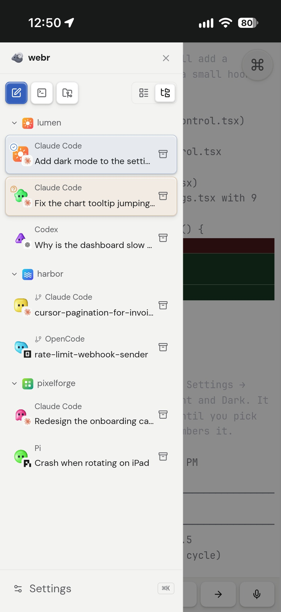
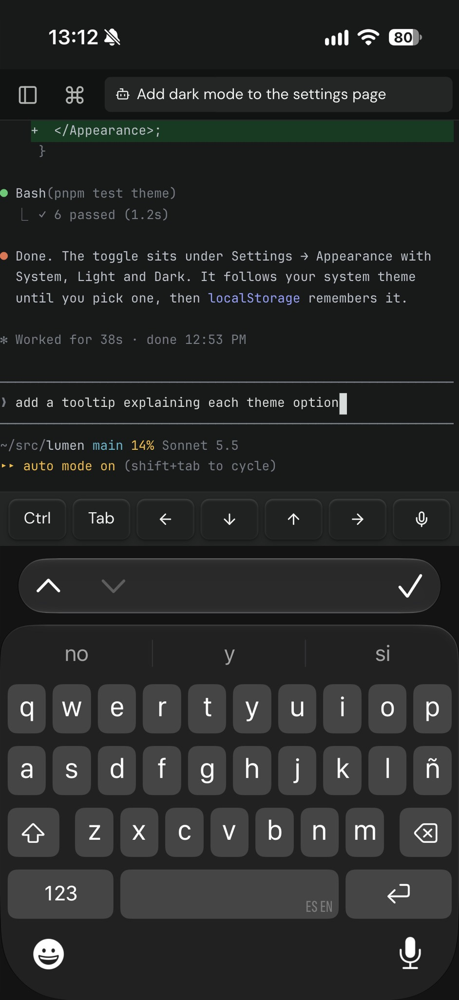
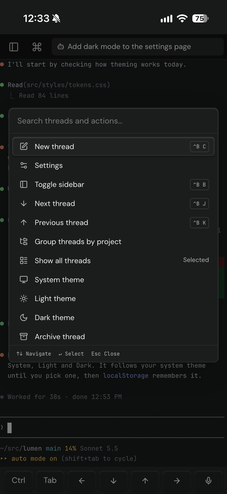

<p align="center">
  
</p>
<p align="center">
  <i align="center">Control your Herdr agents from anywhere.</i>
</p>

<h1 align="center">webr</h1>

> [!IMPORTANT]
> This repo is a WIP. Expect bugs and breaking changes



## Features

- 📱 **Pair by QR code**: scan a one-time code, approve the device from your computer, and revoke it any time.
- 🔒 **Private HTTPS over Tailscale**: Webr picks up your tailnet address automatically, so it works away from home and unlocks the microphone.
- ⌨️ **Real terminal, touch-friendly**: click in mouse-aware TUIs, flick to scroll, plus a key bar with Ctrl, Tab and arrows that keeps the keyboard open.
- 🎙️ **Dictate from your phone**: tap the mic and your speech is transcribed on your own computer with Parakeet v3, in 25 languages. The model loads only while you use it.
- 🪟 **Infinite horizontal panes**: niri-style, every pane in a thread sits on one endless strip you slide through.
- 👀 **Agents at a glance**: threads grouped by project, with live status and a notification when an agent needs you.
- 🖼️ **Attach files**: paste or drop screenshots, or drop any file up to 5 MB, into a prompt. Uploads use temporary storage, not project directories. Works on remote machines too: webr copies the file over SSH.
- 🚀 **Jump anywhere**: a command palette for threads and actions, plus shell-only terminals at home or in a project folder and existing worktrees on remote machines.

## Mobile

Zero config, PWA, with Tailscale automation out of the box.

<table>
  <tr>
    <td colspan="3"></td>
  </tr>
  <tr>
    <td colspan="3"></td>
  </tr>
  <tr>
    <td></td>
    <td></td>
    <td></td>
  </tr>
</table>

## Install

```sh
npx @pablopunk/webr install
```

This installs the Herdr plugin, starts Webr and opens the dashboard, with Tailscale HTTPS configured automatically when it's available.

## Update

For a global install, run `webr update`. For an npx install, refresh the plugin with:

```sh
npx @pablopunk/webr@latest install
```

## Recovery after a restart

Webr keeps agent threads and their provider session identities in its local database. Herdr owns restoring the agent conversation; Webr reconnects the restored pane to the saved thread. Terminal IDs can change across a Herdr restart without creating a new Webr thread.

Install and keep the **official Herdr integration** for your chosen harness current on each machine. The harness picker shows integration health, and the new-thread composer warns if the integration is missing, outdated, unavailable, or could not be checked. You can still launch, but an integration warning means durable recovery is not assured. Even a current integration must actually report a provider session identity before the conversation can be verified.

```sh
herdr integration install omp
herdr integration install opencode
herdr integration status
```

Installations affect newly started agents; an already running agent may need its own integration reload or a deliberate session resume. Do not stop the whole Herdr server just to activate integrations in existing panes.

The sidebar and thread view show recovery separately from the agent's working/idle status:

| Recovery label | Meaning |
| --- | --- |
| **Session unverified** | No verified provider identity is available. A live agent process, shell, or terminal is not proof that the conversation recovered. |
| **Session identity saved** | Webr has the provider identity, but has not verified a matching live conversation yet. |
| **Restoring session** | Webr is waiting for Herdr to restore and verify the saved conversation. |
| **Session verified** | Herdr reports the saved provider session in the expected checkout. |
| **Recovery needs attention** | A missing report, changed target/checkout, conflicting identity, or restore problem prevents safe attachment. The UI explains the reason without exposing raw restore errors. |

Saved agent threads stay visible if Herdr returns only shells or their panes are missing. Opening a detached thread does not redirect you to a new-thread form. Pure shell-only tabs are still not listed as agent threads.

Recovery matches the provider identity within the same machine target and Herdr session, with the expected working directory, repository, and checkout. Webr will not silently attach a thread to a different conversation or resolve conflicting matches by guessing. Its `webr_owner` metadata is a live association hint, not a durable provider identity: that metadata does not survive a Herdr restart. The saved provider identity is what allows the restored conversation to be recognized.

If recovery needs attention, inspect the agent and checkout in Herdr and check the official integration there. Keep the saved thread while resolving the reported mismatch; do not assume a returned shell contains the old conversation. Webr does not implement harness-specific resume commands or infer identities from terminal transcripts.

Initial prompt delivery remains at-most-once. If a launch was interrupted after sending may have begun, Webr does not automatically resend that prompt. Inspect the existing agent before deliberately starting a new thread, or you could duplicate work.


## LICENSE

AGPL-3.0-or-later
